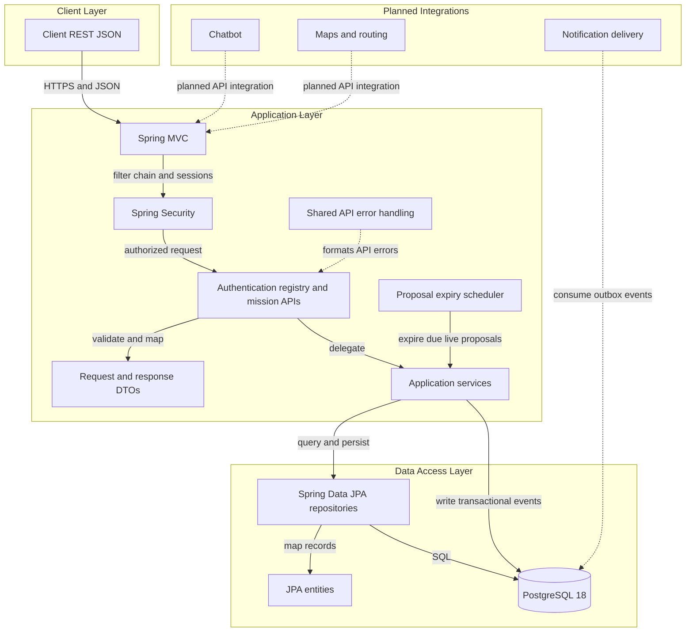
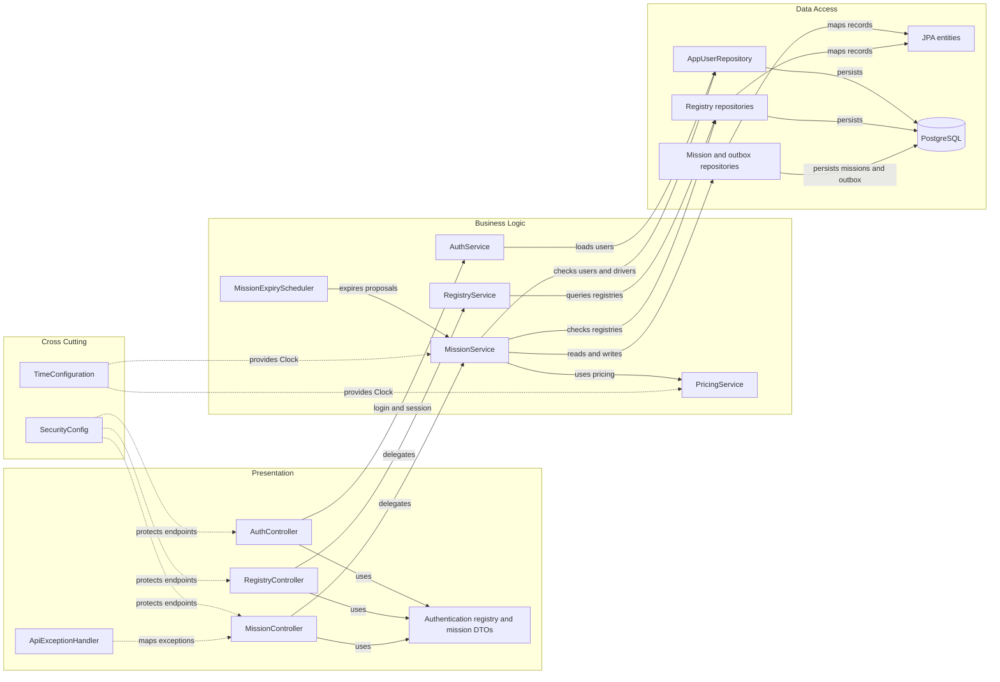

# Architecture Diagram

Questa vista descrive i layer Spring effettivamente presenti nel repository e distingue il backend implementato nel branch Sprint 2 dalle integrazioni consumer ancora pianificate.

## Application Architecture

<!-- mermaid-checked: no \n, no em-dash/en-dash, no {} in labels, subgraphs are id["label"], arrows are -->|"label"|, all subgraphs closed by end, ids unique -->

### Technology Stack Summary

| Layer | Technology | Version | Purpose |
|---|---|---|---|
| Runtime | Java | 25 | Backend runtime and compilation target |
| Application | Spring Boot | 4.1.2 | Dependency injection and application lifecycle |
| HTTP/API | Spring MVC | Spring Boot managed | REST endpoints using JSON |
| Security | Spring Security | Spring Boot managed | Session authentication, role authorization and CSRF |
| Persistence | Spring Data JPA and Hibernate | Spring Boot managed | Repository-based data access and ORM validation |
| Scheduling | Spring scheduling and injected `Clock` | Spring Boot managed | Proposal timeout and deterministic temporal logic |
| Database | PostgreSQL | 18 locally and CI | Users, registries, missions, proposals, events, notes and outbox |
| Build | Maven Wrapper | 3.9.9 | Repeatable build and test execution |

### Data Storage & External Services

PostgreSQL stores user and registry data together with live missions, historical
fixtures, proposal history, audit events, notes, pricing configuration and the
notification outbox. Spring Data JPA accesses these tables; Hibernate validates
the schema at startup. The outbox records accept/completion events transactionally,
but no dispatcher, chatbot provider, map provider or external notification API is
connected yet.

### Key Architectural Decisions

- Packages are divided by Spring layer: `controller`, `dto`, `entity`, `repository`, `service`, `config`, and `common`.
- Services own workflow transactions; pessimistic mission/driver locks and a PostgreSQL constraint protect assignment concurrency.
- Authentication uses server-side sessions, CSRF, BCrypt and role-based authorization; pricing uses an injected `Clock` and Europe/Rome.

## Component Relationships

<!-- mermaid-checked: no \n, no em-dash/en-dash, no {} in labels, subgraphs are id["label"], arrows are -->|"label"|, all subgraphs closed by end, ids unique -->

### Component Inventory

| Component | Layer | Type | Responsibility |
|---|---|---|---|
| `AuthController` | Presentation | REST controller | Login, logout, current user and CSRF endpoints |
| `RegistryController` | Presentation | REST controller | Driver, vehicle, company, customer and workshop APIs |
| `MissionController` | Presentation | REST controller | Mission lifecycle, dashboard, notes and driver APIs |
| `ApiExceptionHandler` | Presentation | REST advice | Maps validation and domain errors to API responses |
| Mission DTOs | Presentation | DTOs | Define mission, proposal, note, dashboard and history payloads |
| `AuthService` | Business logic | Service | Loads the authenticated user's response |
| `RegistryService` | Business logic | Service | Queries registries and validates customer creation |
| `MissionService` | Business logic | Service | Owns mission transitions, authorization, audit and outbox transactions |
| `PricingService` | Business logic | Service | Calculates cost and night surcharge in Europe/Rome |
| `MissionExpiryScheduler` | Business logic | Scheduled component | Expires due live proposals |
| `MissionRepository` and proposal/event/note repositories | Data access | Spring Data repositories | Lock missions and query workflow history |
| `NotificationOutboxRepository` | Data access | Spring Data repository | Stores transactional notification events |
| `DriverRepository` | Data access | Spring Data repository | Locks drivers and resolves authenticated driver identity |
| `SecurityConfig` | Cross cutting | Spring configuration | Configures sessions, CSRF, roles and password encoding |
| `TimeConfiguration` | Cross cutting | Spring configuration | Provides the application `Clock` |
| PostgreSQL | Infrastructure | Relational database | Stores application, registry and mission data |
