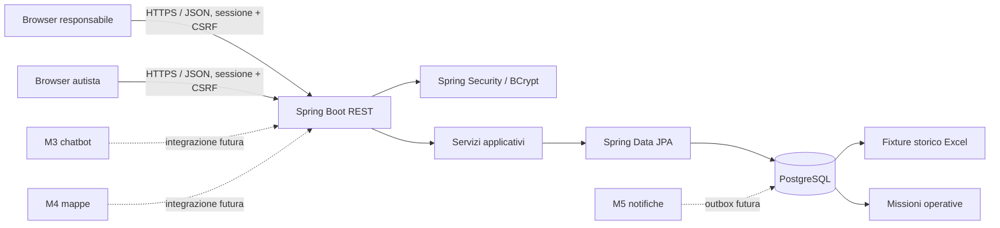

# TAD — FORNITORI (Sprint 1)

**Versione:** 1.1 · **Data:** 03/11/2026 · **Responsabile:** Membro 1 — Architecture Owner 
**Indice:** componenti · package · sicurezza · persistenza · limiti Sprint 1

## Contesto e componenti

Diagramma esteso e versionato: [architecture.mmd](./diagrams/architecture.mmd).
Modello ER: [database_er.mmd](./diagrams/database_er.mmd).

## Struttura implementata

- `controller/`: endpoint REST di autenticazione e anagrafiche.
- `dto/`: richieste e risposte API, separate dalle entità persistenti.
- `entity/`: entità JPA per utenti e anagrafiche.
- `enums/`: ruoli applicativi condivisi tra autorizzazione e autenticazione.
- `repository/`: accesso a PostgreSQL tramite Spring Data JPA.
- `service/`: logica applicativa e coordinamento dei repository.
- `config/`: configurazione Spring Security e sessione HTTP.
- `common`: risposta uniforme per input non valido e conflitti.
- `database/`: schema relazionale, seed fixture, verifiche e assertion baseline.
- `api/openapi.yaml`: contratto con stato implementato/progettato per ogni API.

I controller delegano la logica ai servizi; i servizi usano i repository.
Le API non restituiscono entità JPA né campi password. La struttura segue la
separazione per layer del progetto di riferimento SpringbootES, mantenendo
configurazione e gestione errori in package dedicati.

## Sicurezza e dati

Il server usa sessioni HTTP; login e logout sono JSON/REST e i metodi mutativi
richiedono token CSRF. `/api/v1/**` è riservato al responsabile, ad eccezione delle
future rotte `/api/v1/autista/**`; `/auth/csrf` e login sono accessibili senza
autenticazione. Gli errori di autenticazione e autorizzazione sono JSON `401`/`403`.

Il database separa lo storico importato (`is_fixture=TRUE`) dai nuovi lavori. I
vincoli e l'indice parziale impediscono assegnazioni operative concorrenti; gli
script SQL non alterano né cancellano dati già presenti.

## Fuori perimetro Sprint 1

La macchina a stati, lo scheduler per scadenze, le transazioni di proposta/chiusura,
il calcolo del costo, dashboard, area missioni autista, route mappe, chatbot,
webhook e invio notifiche sono soltanto predisposti nel modello/contratto. Non sono
esposti come funzionalità operative.

**Dipendenze:** PostgreSQL, Java 25, Maven Wrapper, OpenAPI condivisa.
**Criterio di completamento:** i componenti rispettano i confini descritti; le
feature pianificate sono promosse a implementate solo dopo test e review.
**Riferimenti:** [architettura](./02_ARCHITETTURA.md), [database](./03_DATABASE.md),
[contratto](./04_API_REST.md), [rischi](./13_RISCHI_E_IMPEDIMENTI.md).
