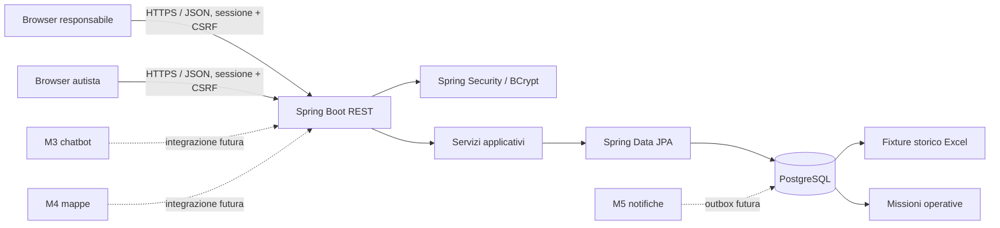

# TAD — FORNITORI (backend Sprint 2)

**Versione:** 1.2 · **Data:** 03/11/2026 · **Responsabile:** Membro 1 — Architecture Owner 
**Indice:** componenti · package · sicurezza · persistenza · workflow Sprint 2

## Contesto e componenti

Diagramma esteso Spring: [architecture-diagram.md](../.github/modernize/assessment/engines/facts/architecture-diagram.md).
Diagramma di contesto: [architecture.mmd](./diagrams/architecture.mmd).
Modello ER: [database_er.mmd](./diagrams/database_er.mmd).

## Struttura implementata

- `controller/`: endpoint REST di autenticazione, anagrafiche e missioni.
- `dto/`: richieste e risposte API, separate dalle entità persistenti.
- `entity/`: entità JPA per utenti, anagrafiche, missioni, proposte, note, audit e outbox.
- `enums/`: ruoli applicativi condivisi tra autorizzazione e autenticazione.
- `repository/`: accesso a PostgreSQL tramite Spring Data JPA.
- `service/`: logica applicativa, workflow missioni, pricing e scadenze.
- `config/`: Spring Security, sessione HTTP e `Clock` iniettato.
- `common`: risposta uniforme per input non valido e conflitti.
- `database/`: schema relazionale, seed fixture, verifiche e assertion baseline.
- `api/openapi.yaml`: contratto con stato implementato/progettato per ogni API.

I controller delegano la logica ai servizi; i servizi usano i repository.
Le API non restituiscono entità JPA né campi password. La struttura segue la
separazione per layer del progetto di riferimento SpringbootES, mantenendo
configurazione e gestione errori in package dedicati.

## Sicurezza e dati

Il server usa sessioni HTTP; login e logout sono JSON/REST e i metodi mutativi
richiedono token CSRF. Le rotte autista richiedono AUTISTA; i dettagli e le note
missione sono filtrati ulteriormente dal service per autista assegnato/proponente.
Le API centrali richiedono RESPONSABILE; `/auth/csrf` e login sono accessibili senza
autenticazione. Gli errori di autenticazione e autorizzazione sono JSON `401`/`403`.

Il database separa lo storico importato (`is_fixture=TRUE`) dai nuovi lavori.
Vincoli e indice parziale impediscono assegnazioni operative concorrenti; missioni,
proposte, audit e outbox sono persistiti con transazioni. Lo scheduler opera solo
su righe live. Gli script SQL non alterano né cancellano dati già presenti.

## Stato e fuori perimetro

Workflow missioni, timeout, pricing, rettifiche, dashboard, note e area missioni
autista sono implementati sul branch `feature/backend` e validati con PostgreSQL
CI. Routing mappe, chatbot, webhook e invio notifiche non
sono implementati; l'outbox non invia messaggi esterni.

**Dipendenze:** PostgreSQL, Java 25, Maven Wrapper, OpenAPI condivisa.
**Criterio di completamento:** i componenti rispettano i confini descritti; le
feature pianificate sono promosse a implementate solo dopo test e review.
**Riferimenti:** [architettura](./02_ARCHITETTURA.md), [database](./03_DATABASE.md),
[contratto](./04_API_REST.md), [rischi](./13_RISCHI_E_IMPEDIMENTI.md).
