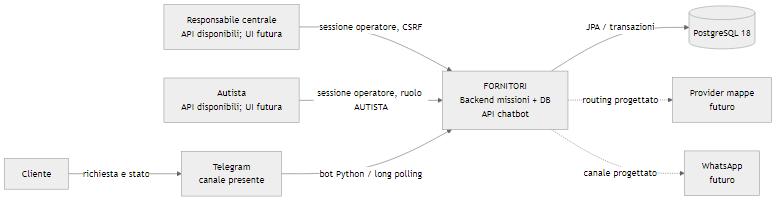
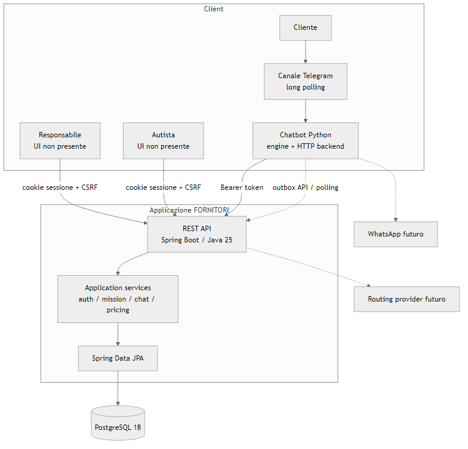
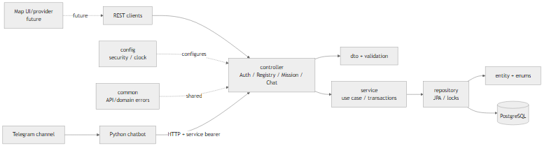

# Technical Architecture Document — FORNITORI

**Codice:** FOR-TAD-001 · **Versione:** 1.0 · **Data:** 03/11/2026
**Repository baseline:** `main` / `25c613b` · **Responsabile:** M1 tecnico; approvazione architetturale da confermare
**Stato:** architettura descrittiva della baseline implementata e delle estensioni future

## 1. Sintesi tecnica

FORNITORI è un'applicazione backend Java con API REST, persistenza PostgreSQL e
client chatbot Python. Il backend copre autenticazione operatori, anagrafiche,
missioni, pricing, audit e API stateless protette da token per chatbot/outbox. Il
bot usa backend fake o HTTP; Telegram usa long polling. CI verifica Java 25,
OpenAPI, schema/seed e test PostgreSQL 18.

Non esiste un frontend web nel repository. Calcolo itinerari, webhook in ingresso,
WhatsApp e deployment di produzione non sono runtime implementati. Un disegno
architetturale deve quindi mostrare separatamente blocchi presenti e proposti.

## 2. Fonti e stack

| Tecnologia | Versione/prova | Stato |
|---|---|---|
| Java | 25 in `pom.xml` e workflow Temurin | Implementato; job CI PASS |
| Spring Boot | Parent `4.1.2` in `pom.xml` | Implementato |
| Maven | Wrapper distribuito 3.9.9 secondo README | Build `clean verify` in CI |
| Spring Security / JPA / Validation / WebMVC | Starter del POM | Implementati |
| PostgreSQL | 18 nel servizio del workflow | Schema/seed/assert e test in CI PASS |
| Python | chatbot dichiara Python >=3.10 e stdlib | Modulo e test presenti |
| OpenAPI | 3.0.3 in `api/openapi.yaml` | 34 operazioni: 29 implementate, 5 progettate; la description iniziale è obsoleta |
| Frontend | Nessun package frontend nella working tree | Non implementato |
| Mappe | API `maps/route` marcata `designed` | Pianificato |
| Messaging | Telegram long polling; notifiche via dispatcher | Presente, test unitari; prova reale è documentata nel README chatbot |
| WhatsApp | Webhook nello YAML, `designed` | Pianificato |

## 3. Obiettivi e vincoli

- Separare HTTP, use case, accesso dati e modello persistente.
- Distinguere le fixture storiche dalle missioni operative.
- Enforce lato server ruoli, proprietà della missione, deadline e vincoli concorrenti.
- Evitare che chatbot/notifiche accedano direttamente alle tabelle.
- Rendere verificabili costi, deadline e webhook tramite clock/test deterministici.
- Non esporre credenziali o password/hash nelle API.

## 4. Contesto e container

Il diagramma di contesto e quello container in
[`diagrams/`](../diagrams/) separano utenti, REST backend, database, chatbot e
provider effettivo. Il bot si collega alle API `/api/v1/chat/*` con Bearer token;
lo schema non è un'interfaccia d'integrazione dei client.





## 5. Componenti e dipendenze

```text
REST controller -> DTO/validazione -> service transazionale -> repository JPA -> PostgreSQL
                                             |                    |
                                             +-> pricing/clock    +-> outbox
Python bot -> Backend interface -> HTTP backend -> /api/v1/chat/* -> service backend
Telegram long polling -> dialog engine -> outbound notification dispatcher -> Telegram
```



| Componente | Responsabilità | Stato/evidenza |
|---|---|---|
| `controller/` | Auth, Registry, Mission, Chat; mapping HTTP e DTO | Implementato |
| `dto/` | Payload distinti dalle entità persistenti | Implementato |
| `service/` | Auth, anagrafiche, missioni, pricing, expiry, chat | Implementato |
| `repository/` | Query e lock pessimistici JPA | Implementato |
| `entity/`, `enums/` | Mapping e stati/ruoli | Implementato |
| `config/` | Security filter chain, clock, configurazione | Implementato |
| `common/` | Errori di dominio/API | Implementato |
| `database/` | Schema, seed, verifiche e baseline più migrazioni additive chat | Implementato |
| `chatbot/fornitori_chatbot/` | Conversazione, fake/HTTP backend, Telegram, notifiche | Implementato; limiti nel suo README |
| UI web | Dashboard browser centrale/autista | Pianificato, assente |
| Map adapter | Geocoding/routing | Pianificato; solo API `designed` |
| Webhook provider | Ingresso Telegram/WhatsApp al backend | `designed`, distinto dal bot Telegram a long polling |
| WhatsApp | Invio/ricezione provider | Pianificato |

## 6. Backend e workflow

### Sicurezza

La chain `/api/v1/chat/**` è stateless e token-based (`FORNITORI_CHAT_TOKEN`),
senza CSRF di sessione. Le API operatori usano sessione HTTP, password BCrypt e
CSRF repository HTTP session; i controlli centrali/autista sono server-side. Il
servizio deve anche controllare l'associazione missione-driver, non soltanto il
ruolo. Cookie: HttpOnly e SameSite Lax; flag Secure configurabile.

### Transazioni, locking e stato

`MissionService` racchiude mutazioni in transazioni; i repository usano lock
pessimistici in operazioni critiche; indici parziali PostgreSQL limitano
assegnazioni/proposte LIVE. Un clock iniettato supporta deadline deterministiche.
`MissionExpiryScheduler` opera sulle righe live. Diagramma stati aggiornato:
[`mission_states.mmd`](../diagrams/mission_states.mmd).

Gli stati persistiti nello schema includono `nuova`, `proposta`, `accettata`,
`eseguita`, `non_accettata`, `scaduta`. Riproposizione crea una nuova proposta
senza cancellare lo storico. Le fixture `is_fixture=TRUE` non sono work items live.

### Prezzi e outbox

La configurazione del seed è €50 di uscita, €1,20/km, supplemento 0,25 e fascia
20:00–08:00; il servizio usa `Europe/Rome` e `HALF_UP`. Il timestamp applicato va
confermato col docente: il foglio e i log descrivono l'accettazione, il PDF non è
disponibile. Gli eventi di completamento/accettazione sono registrati con outbox
nella transazione. La presenza di outbox non equivale a consegna garantita:
il dispatcher Telegram processa i canali supportati; WhatsApp non è implementato.

## 7. Database e integrità

Schema relazionale in `database/01_schema.sql`, seed in `02_seed.sql`, verifiche
`03_verifiche.sql`/`04_assert_baseline.sql`; `05_chat_requests.sql` e
`06_chat_recipient.sql` aggiungono schema chatbot. Il POM usa Hibernate `validate`,
non auto-update. Tabelle: app_users, vehicles, drivers, insurance_companies,
customers, workshops, pricing_config, missions, mission_proposals, mission_notes,
mission_events, chat_sessions, notifications_outbox.

Importi `NUMERIC`; istanti `TIMESTAMPTZ`; coordinate validate; FK e vincoli di
stato/proposta; `targa_norm` univoca; eventi con dettagli JSONB. Dizionario e diagramma
ER: [`DATABASE_DESIGN.md`](./DATABASE_DESIGN.md),
[`DATA_DICTIONARY.md`](./DATA_DICTIONARY.md) e
[`database_er.mmd`](../diagrams/database_er.mmd).

## 8. API e integrazioni

`api/openapi.yaml` è il contratto dettagliato. Gli operatori usano sessione cookie
e CSRF per mutazioni. Il bot usa token Bearer e endpoint `/api/v1/chat/*`; il canale
Telegram usa long polling senza webhook backend. Route mappe e webhook in ingresso
sono marcati `designed`; non vanno chiamati come runtime disponibile. Riferimenti:
[`API_SPECIFICATION.md`](./API_SPECIFICATION.md) e
[`INTEGRATION_DESIGN.md`](./INTEGRATION_DESIGN.md).

## 9. Errori, configurazione e logging

Errori applicativi sono tradotti in status HTTP strutturati; sicurezza emette JSON
`401/403`. Configurazione da environment, fra cui datasource e token chatbot; non
registrare password, bearer token, messaggi privati o dati cliente non necessari.
La configurazione locale usa `application.properties`; configurazioni production,
centralizzazione log, metriche, tracing e retention non risultano presenti.

## 10. Build, test, CI e deployment

La CI `.github/workflows/backend-ci.yml` ha due job: Java 25 build/test, layout
package e validazione YAML; PostgreSQL 18, esecuzione script, assertion baseline e
test d'integrazione. Sul commit `25c613b` il run `41651140562` è verde in entrambi
i job. Non certifica UI, routing, WhatsApp o messa in produzione.
Non sono presenti in questa baseline manifest cloud/container/deployment.

## 11. Decisioni aperte e debito tecnico

- Mancano specifica originale e consenso/acceptance docente.
- La verifica chat tramite targa non è autenticazione del titolare.
- Stato conversazione volatile in RAM; riavvio perde le sessioni.
- Frontend e mappe non implementati; nessuna schermata reale da documentare.
- WhatsApp e Webhook API disegnate ma non realizzate.
- Descrizione `info.description` OpenAPI è vecchia, benché i metadati per singola
  operazione siano aggiornati; aggiornamento affidato al contract owner.
- Deployment, backup/restore, osservabilità e policy segreti production non definiti.

## 12. Evoluzioni future

Priorità: acquisire fonti docente e convalidare l'identità; stabilire UI/provider
richiesti; aggiornare contratto e test in modo coordinato; solo poi pianificare
routing, WhatsApp, persistenza conversazioni e infrastruttura. Le alternative non
sono decisioni approvate. Questo documento non dichiara conformità a standard.
